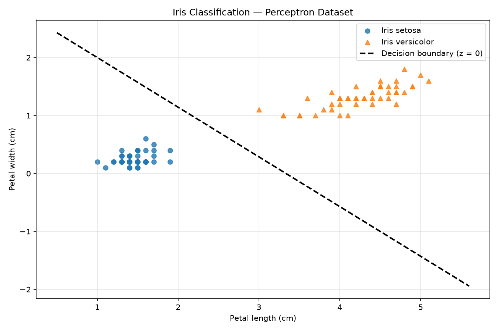
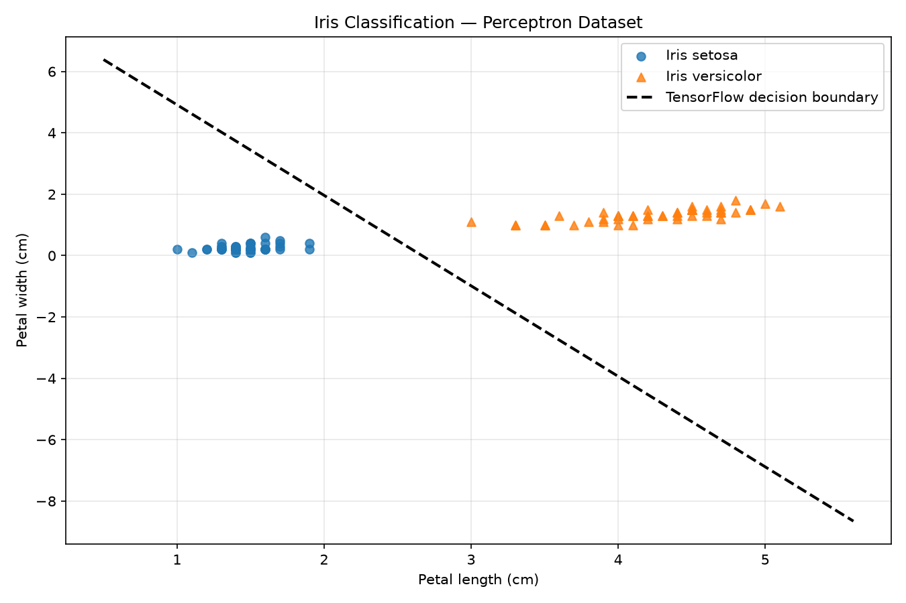

# Perceptron from Scratch — Iris Classification

A mini-project exploring the fundamentals of neural networks by implementing a perceptron using NumPy and TensorFlow, then comparing their learned decision boundaries on the Iris dataset.

The project demonstrates how weights, biases, and learning rules allow a model to learn a linear decision boundary from labeled data.

## Project Overview

A **perceptron** is one of the simplest artificial neural network models. It combines input features using learned weights and a bias, then applies an activation function to make a classification.

This project uses two features from the Iris dataset:

- **Petal length**
- **Petal width**

The model distinguishes between two Iris species:

- Iris setosa — class `0`
- Iris versicolor — class `1`

Two implementations are explored:

- **Manual implementation:** The perceptron learning algorithm implemented using NumPy.
- **TensorFlow implementation:** A corresponding implementation using TensorFlow operations.

The goal is to understand the algorithm beyond simply using a prebuilt machine learning estimator.

## Visualizations

### 1. Manual Perceptron — NumPy

The manually implemented perceptron learns its weights and bias by updating its parameters when it misclassifies a training sample.



*Figure 1: Decision boundary learned by the NumPy implementation.*

### 2. TensorFlow Perceptron

The TensorFlow implementation provides a second way to implement the learning process. Its learned decision boundary can be compared with the NumPy version to examine differences in training and parameter updates.



*Figure 2: Decision boundary learned by the TensorFlow implementation.*

The two boundaries may differ because of training order, initialization, implementation details, or stopping conditions. If both implementations use the classic perceptron learning rule and the same data ordering, their results may be more directly comparable.

## What Is a Perceptron?

A perceptron is a single artificial neuron commonly used for binary classification. It receives numerical inputs, multiplies each input by a weight, adds a bias, and applies an activation function.

For two input features, the weighted sum is:

\[
z = w_1x_1 + w_2x_2 + b
\]

Where:

- \(x_1, x_2\) are the input features.
- \(w_1, w_2\) are the learned weights.
- \(b\) is the bias.
- \(z\) is the weighted sum before activation.

The classic perceptron uses a step activation function:

\[
\hat{y} =
\begin{cases}
1 & z \geq 0 \\
0 & z < 0
\end{cases}
\]

The weights determine how each feature influences the prediction, while the bias shifts the decision boundary.

### How Does a Perceptron Learn?

The perceptron learns by comparing its prediction with the actual label and adjusting its parameters when it makes a mistake.

The weight update rule is:

\[
w_i \leftarrow w_i + \eta(y-\hat{y})x_i
\]

The bias is updated using:

\[
b \leftarrow b + \eta(y-\hat{y})
\]

Where:

- \(y\) is the actual label.
- \(\hat{y}\) is the predicted label.
- \(\eta\) is the learning rate.

If the prediction is correct, the update is zero. If it is incorrect, the model adjusts its weights and bias.

This process repeats over multiple epochs until the model makes no mistakes on the training data or reaches the maximum number of epochs.

A classic perceptron converges when the training data is linearly separable, assuming the standard perceptron learning procedure. It cannot guarantee perfect classification when the classes cannot be separated by a straight line.

### Understanding the Decision Boundary

The decision boundary is where the weighted sum equals zero:

\[
w_1x_1 + w_2x_2 + b = 0
\]

Rearranging for the second feature gives:

\[
x_2 = -\frac{w_1x_1+b}{w_2}
\]

This equation describes a straight line in the two-dimensional feature space.

Points on one side of the line are classified as class `0`, while points on the other side are classified as class `1`. The learned weights and bias determine the line's orientation and position.

## Implementation

### 1. NumPy Implementation

The manual implementation uses NumPy to implement the classic perceptron algorithm without relying on a prebuilt classifier.

It includes:

- Weight and bias initialization.
- Weighted-sum calculation.
- Step activation function.
- Perceptron learning rule.
- Iterative training with an epoch limit.
- Prediction on unseen test data.

This makes the underlying learning mechanism explicit and shows how a model can learn from classification errors.

### 2. TensorFlow Implementation

The TensorFlow implementation explores the same classification task using TensorFlow's tensor operations and variables.

If the implementation manually applies the classic perceptron update rule, it follows the same basic learning procedure as the NumPy model while using TensorFlow for numerical operations.

If a Keras dense layer with sigmoid activation and binary cross-entropy is used instead, that model is technically **logistic regression implemented as a single-neuron neural network**, rather than the classic perceptron algorithm. The distinction matters when interpreting and comparing the resulting graphs.

### 3. Model Evaluation

The models can be evaluated on a held-out test set using accuracy:

\[
\text{Accuracy} =
\frac{\text{Correct Predictions}}{\text{Total Predictions}}
\times 100
\]

Test accuracy measures the proportion of unseen examples classified correctly.

The experiment can compare the NumPy and TensorFlow implementations. Differences in accuracy and decision boundaries can help illustrate the effect of training procedures, initialization, and parameter updates.

## Mini-Project Objectives

This project was designed to build a practical understanding of fundamental machine learning concepts:

1. Understand how a neuron combines inputs using weights and a bias.
2. Implement binary classification from scratch.
3. Observe how a model learns a linear decision boundary.
4. Separate training and testing data to evaluate generalization.
5. Visualize the dataset and learned decision boundaries.
6. Compare manual numerical implementation with a machine learning framework.
7. Understand the difference between a classic perceptron and logistic regression.

## Technologies Used

- **Python** — implementation
- **NumPy** — numerical computation and manual perceptron
- **TensorFlow / Keras** — neural-network experimentation
- **scikit-learn** — dataset preparation, splitting, and optional baseline comparison
- **Matplotlib** — dataset and decision-boundary visualization

## Project Structure

```text
PerceptronExperiment/
├── main.py
├── perceptron.py
├── tensorflow_perceptron.py
├── Dataset.py
├── plotting.py
├── iris_plot.png
├── decision_boundary.png
├── tensorflow_decision_boundary.png
├── requirements.txt
└── README.md
```

## Running the Project

### 1. Clone the repository

```bash
git clone <your-repository-url>
cd PerceptronExperiment
```

### 2. Create and activate a virtual environment

```bash
python3 -m venv .venv
source .venv/bin/activate
```

### 3. Install dependencies

```bash
pip install -r requirements.txt
```

Alternatively, install the required packages directly:

```bash
pip install numpy matplotlib scikit-learn tensorflow
```

### 4. Run the experiment

```bash
python3 main.py
```

Run the plotting script separately if visualizations are generated independently:

```bash
python3 plotting.py
```

## Key Takeaways

The perceptron demonstrates how a learning algorithm can discover a decision boundary from labeled examples rather than requiring it to be drawn manually.

Although modern neural networks are much more complex, weighted inputs, biases, activation functions, and parameter learning remain central concepts in neural-network design.

This experiment provides a foundation for exploring logistic regression, multilayer perceptrons, gradient descent, and deep learning for computer vision.

## Future Improvements

- Compare accuracy across different learning rates and epoch limits.
- Investigate how feature standardization affects training.
- Compare the classic perceptron with logistic regression and a linear SVM.
- Visualize classification errors across epochs.
- Test the algorithm on data that is not linearly separable.
- Extend the experiment to multilayer neural networks.

---

**Focus:** Machine Learning · Neural Networks · Binary Classification
